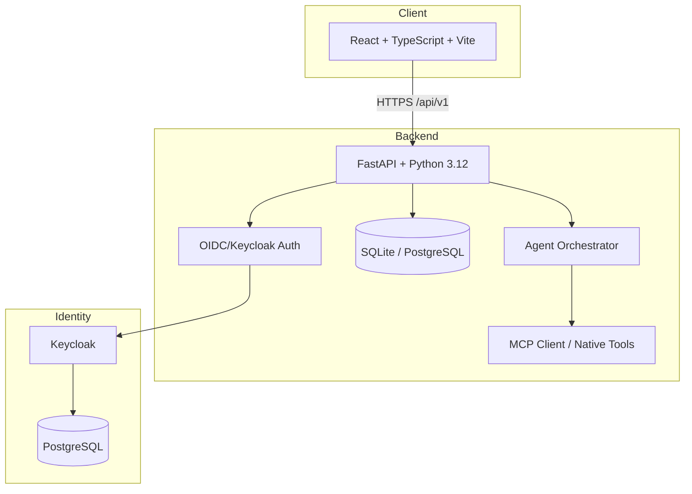

# Atlas Console | AI & Machine Learning

> Work in progress. This checkpoint may be incomplete or fail tests. See PLAN.md and STATUS.md before use.


**Atlas Console** is an autonomous AI agent platform for penetration testing, built by Alan Vo (alanvo@gmail.com).

## Problem

Penetration testing is time-consuming, repetitive, and requires deep expertise across many domains (reconnaissance, vulnerability scanning, exploitation, post-exploitation, reporting). Security teams struggle to keep up with expanding attack surfaces and evolving threat landscapes.

## Approach

Atlas Console deploys autonomous AI agents that collaborate to execute complete penetration testing workflows:

- **Reconnaissance Agent** — Discovers assets, enumerates services, maps attack surface
- **Scanner Agent** — Runs vulnerability scans, correlates findings, prioritizes targets
- **Exploitation Agent** — Attempts safe exploitation, validates vulnerabilities
- **Reporting Agent** — Generates executive summaries, technical findings, remediation guidance

All agents operate within a defined **Scope** (IP ranges, allowed ports, excluded assets) with full audit logging. The system works offline with a deterministic core — no LLM keys required for basic operation. LLM-enhanced reasoning is opt-in, advisory, and grounded in actual scan results.

## Intended Users

- Red teams and penetration testers seeking force multiplication
- Security consultants needing consistent, repeatable methodology
- Organizations wanting continuous security validation
- Researchers evaluating AI agent coordination for security tasks

## Quick Start

### Prerequisites

- Docker 24+ and Docker Compose v2+
- 4 GB RAM minimum (8 GB recommended)

### Development Mode

```bash
# Clone and enter
git clone https://github.com/ALANDVO/atlas-console-alan-vo.git
cd atlas-console-alan-vo

# Copy env template
cp .env.example .env

# Enable demo mode for local testing (creates demo@atlas.local / demo)
echo "DEMO_MODE=true" >> .env

# Start all services
docker compose up -d

# Access
# Frontend: http://localhost:3000
# Backend API: http://localhost:8000
# API Docs: http://localhost:8000/docs
# Keycloak: http://localhost:8080 (admin/admin)
```

### Demo Credentials (DEMO_MODE=true)

| Email | Password | Role |
|-------|----------|------|
| demo@atlas.local | demo | operator |
| admin@atlas.local | admin | admin (via Keycloak) |
| operator@atlas.local | operator | operator (via Keycloak) |
| viewer@atlas.local | viewer | viewer (via Keycloak) |

### Production Deployment

1. Generate a strong `SECRET_KEY`: `openssl rand -base64 32`
2. Configure Keycloak with your realm and client
3. Set `OIDC_*` variables to point to your Keycloak instance
4. Set `DEMO_MODE=false`
5. Use PostgreSQL: `DATABASE_URL=postgresql+asyncpg://user:pass@db:5432/atlas`
6. Deploy behind TLS-terminating reverse proxy (nginx, Traefik, Caddy)
7. Configure backups for SQLite/PostgreSQL data volume

## Architecture



## Features

| Feature | Status | Description |
|---------|--------|-------------|
| OIDC Authentication | ✅ | Keycloak integration with PKCE, roles (viewer/operator/admin) |
| Demo Mode | ✅ | Local-first auth for development |
| Dashboard | ✅ | Stats, recent activity, quick actions |
| Scope Management | 🔄 | IP/CIDR, port ranges, service allowlists |
| Resource Library | 🔄 | Paginated, virtual-scrolled artifact browser |
| MCP Client | 🔄 | Connect Burp Suite, Nuclei, custom tools |
| LLM Provider UI | 🔄 | Web-based OpenAI-compatible provider config |
| Penetration Flows | 🔄 | Multi-agent orchestration with progress tracking |
| Markdown Rendering | 🔄 | Nested code block safe renderer |

✅ = Implemented | 🔄 = Planned/In Progress

## API Endpoints

### Authentication
- `POST /api/v1/auth/login` — Email/password (demo mode only)
- `POST /api/v1/auth/demo/token` — Get demo token (demo mode only)
- `POST /api/v1/auth/refresh` — Refresh access token
- `POST /api/v1/auth/logout` — Clear session
- `GET /api/v1/auth/me` — Current user info
- `GET /api/v1/auth/oidc/login` — Initiate OIDC flow
- `POST /api/v1/auth/oidc/callback` — Handle OIDC callback
- `GET /api/v1/auth/oidc/logout` — Initiate Keycloak logout

### Dashboard
- `GET /api/v1/dashboard` — Full dashboard data
- `GET /api/v1/dashboard/stats` — Statistics only

### Health
- `GET /health` — Service health
- `GET /api/v1/info` — Version and config info

## Security

- **Authentication**: OIDC authorization code flow with PKCE, HttpOnly cookies, CSRF protection
- **Authorization**: Role-based (viewer/operator/admin) on all data endpoints
- **Tokens**: JWT with short expiry, refresh token rotation
- **Passwords**: bcrypt with default cost factor
- **Secrets**: Never logged, never in repo, encrypted at rest (planned)
- **Demo Mode**: Explicitly opt-in, refuses to start in production (checks `DEMO_MODE` + non-localhost)

### Limitations

- SQLite is development-only; use PostgreSQL in production
- No built-in WAF or rate limiting (deploy behind proxy)
- LLM provider credentials stored in Keycloak/user DB (planned encryption)
- Agent sandboxing via Docker requires `DOCKER_INSIDE_HOST` config
- No native SAML — use Keycloak identity brokering for SAML IdPs

## AI/ML Evaluation

Atlas Console's AI/ML capabilities center on **agent orchestration for penetration testing**. The deterministic offline core executes workflows without any LLM. LLM integration is advisory only.

### Reproducible Baseline

```bash
# Run a test flow against a local target (requires Docker)
docker compose exec backend python -m app.services.flow_orchestrator \
  --target 192.168.1.100 \
  --scope 192.168.1.0/24 \
  --agents recon,scanner \
  --no-llm
```

### Metrics (Planned)

| Metric | Target | Measurement |
|--------|--------|-------------|
| Asset discovery recall | >90% | vs. nmap baseline |
| Vulnerability detection precision | >80% | vs. CVE database |
| Exploitation safety | 100% | No unintended system changes |
| Flow completion time | <30 min | Typical web app |
| False positive rate | <15% | Manual verification |

### Failure Cases

- **LLM hallucination**: Advisory output only; never drives tool execution directly
- **Scope drift**: Agents validate every action against scope; out-of-scope actions blocked
- **Tool failures**: Graceful degradation; partial results preserved
- **Agent loops**: Step budgets and cycle detection terminate runaway flows

## Configuration

### Provider Configuration Table

| Provider | Type | Env Variables | Notes |
|----------|------|---------------|-------|
| OpenAI | openai-compatible | `OPENAI_API_KEY` | Official API |
| Anthropic | anthropic | `ANTHROPIC_API_KEY` | Messages API |
| Google Gemini | gemini | `GOOGLE_API_KEY` | generateContent |
| Ollama | ollama | `OLLAMA_BASE_URL` | Local models |
| LiteLLM | openai-compatible | `LITELLM_API_KEY`, `LITELLM_BASE_URL` | Proxy |
| OpenRouter | openai-compatible | `OPENROUTER_API_KEY`, `OPENROUTER_BASE_URL` | Multi-model |
| vLLM | openai-compatible | `VLLM_API_KEY`, `VLLM_BASE_URL` | Self-hosted |
| OneAPI | openai-compatible | `ONEAPI_API_KEY`, `ONEAPI_BASE_URL` | Gateway |

All providers use OpenAI-compatible or native adapters with httpx. Configure via UI (planned) or environment variables.

### SSO/SAML Setup

Keycloak supports SAML 2.0 identity brokering:

1. In Keycloak Admin Console: Identity Providers → Add SAML v2.0
2. Configure IdP metadata / entity ID / SSO URL
3. Map SAML attributes to Keycloak claims (email, name, groups)
4. Enable "First Login Flow" to link or create local accounts
5. Test with `oidc_login` flow from Atlas Console

## Development

### Backend

```bash
cd backend
python -m venv .venv
source .venv/bin/activate
pip install -r requirements.txt
python -m pytest tests/ -v
uvicorn app.main:app --reload --host 127.0.0.1 --port 8000
```

### Frontend

```bash
cd frontend
npm install
npm run dev  # http://localhost:3000
npm run build
npm test
```

### Database Migrations

```bash
cd backend
alembic revision --autogenerate -m "description"
alembic upgrade head
```

## Project Structure

```
atlas-console-alan-vo/
├── backend/
│   ├── app/
│   │   ├── main.py              # FastAPI app factory
│   │   ├── core/                # Config, security, database
│   │   ├── models/              # SQLAlchemy models
│   │   ├── api/                 # Route handlers
│   │   └── services/            # Business logic
│   ├── tests/                   # Pytest tests
│   ├── requirements.txt
│   └── Dockerfile
├── frontend/
│   ├── src/
│   │   ├── pages/               # Route components
│   │   ├── components/          # Reusable components
│   │   ├── api/                 # Typed API client
│   │   └── hooks/               # React state
│   ├── tests/                   # Vitest tests
│   ├── package.json
│   └── Dockerfile
├── keycloak/
│   └── realm-export.json        # Keycloak realm import
├── compose.yaml                 # Docker Compose
├── .env.example
├── .github/workflows/ci.yml
├── portfolio.json
├── LICENSE
├── CHANGELOG.md
├── pyproject.toml
└── README.md
```

## License

MIT License — see [LICENSE](LICENSE) for details.

Copyright (c) 2024 Alan Vo <alanvo@gmail.com>

## Changelog

See [CHANGELOG.md](CHANGELOG.md) for release history.

---

*Atlas Console — Autonomous AI Penetration Testing Platform*
*Alan Vo | AI & Machine Learning*